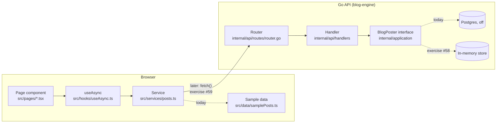

# Learning map

This repo is a blog, and also a place to learn full-stack development by changing it. This page shows where each kind of change lives, so you can go "this is HTML, this is CSS, this is a TypeScript feature, this is the wiring to Go" and open the right file.

Look for `LEARN:` comments in the code. Each one marks a seam described here.

## How the pieces fit



Today the frontend reads hardcoded sample posts, and the Go API's post routes are off (the database is disabled). The exercises connect them, one layer at a time.

## Where do I change…

| I want to change… | Layer | Where |
| --- | --- | --- |
| What's on a page (headings, sections, order) | HTML, written as JSX | `devel-frontend/src/pages/*.tsx` |
| A reusable piece (card, tag chips, header) | React component | `devel-frontend/src/components/` |
| Spacing, colors, sizes on one element | CSS, written as Tailwind classes | the `className` on that element |
| Fonts or the accent color everywhere | Design tokens | `devel-frontend/src/index.css` (`@theme`) |
| How Markdown looks in posts | Typography plugin | the `prose-*` classes in `src/components/Markdown.tsx` |
| Site name, tagline, author | Config | `devel-frontend/src/config/site.ts` |
| Which URLs exist | Client-side routing | `devel-frontend/src/app/AppRoutes.tsx` |
| Behavior: state, effects, interactivity | TypeScript, React hooks | `devel-frontend/src/hooks/`, or the component itself |
| Pure logic (reading time, headings) | TypeScript functions | `devel-frontend/src/lib/` (each has a `.test.ts`) |
| Where posts come from | Data access | `devel-frontend/src/services/posts.ts` |
| The shape of a post | Data contract | `devel-frontend/src/types/post.ts` ↔ `blog-engine/internal/domain/blog/post.go` |
| A new API endpoint | Go routing and handlers | `blog-engine/internal/api/routes/router.go`, `internal/api/handlers/` |
| Business logic, storage | Go service layer | `blog-engine/internal/application/` |
| Which implementation the API uses | Go wiring | `blog-engine/cmd/blog-engine/main.go` |
| API URL, CORS origins, ports | Config | `VITE_API_BASE_URL` (frontend), `blog-engine/configs/*.yaml` (API) |

### Styling

Tailwind turns class names into CSS: `text-lg` sets the font size, `dark:bg-zinc-950` applies only in dark mode, and `sm:grid-cols-2` applies from the small breakpoint up. The search box in the [Tailwind docs](https://tailwindcss.com/docs) is the fastest way to find a class. The theme tokens in `index.css` (fonts and the `accent` color) generate classes like `font-serif` and `bg-accent-600`, so changing a token restyles every page.

### Data shape

`types/post.ts` uses the same field names as the Go struct's `json:"..."` tags (`post_id`, `body_markdown`, …). That's deliberate: when the frontend switches to the real API, the JSON drops straight into the same type. If you add a field on one side, add it on the other.

### Wiring to the Go API

Pages never fetch directly; they call `getPosts()` and `getPostBySlug()` in `services/posts.ts`. Swapping those two functions from sample data to `fetch()` connects the whole site to Go (exercise #59). On the Go side, handlers depend on the `BlogPoster` interface, so `main.go` can hand them a Postgres-backed service or an in-memory one (exercise #58).

One real decision is waiting in the middle: post URLs use slugs (`/posts/net-http-router`), but the API only looks posts up by numeric ID. Exercise #58 adds a slug route. Frontend and backend have to agree on the contract.

## Run it locally

```bash
# Frontend only, with sample data: http://localhost:3000
cd devel-frontend
npm install
npm run dev

# Frontend and API together
./run-local-dev.sh
```

In `devel-frontend/`, `npm test` runs the tests, `npm run lint` checks the code, and `npm run build` type-checks and builds. In `blog-engine/`, run `go test ./...` and `go vet ./...`.

## Trace one request

A good first exercise is to follow a click all the way through:

1. Open http://localhost:3000 and click a post. The URL changes to `/posts/<slug>` without a full page load: `AppRoutes.tsx` matched it.
2. `PostPage.tsx` reads the slug with `useParams()` and calls `useAsync(getPostBySlug, slug)`.
3. `services/posts.ts` returns the post: from sample data today, and from the Go API after exercise #59.
4. `Markdown.tsx` turns `body_markdown` into HTML, and `TableOfContents` links to its headings.

Put a `console.log`, or a breakpoint in the browser dev tools' Sources tab, at each step and watch it happen.

## Exercises

In suggested order. Each is a GitHub issue labelled `learning` on the project board.

1. [#55 Make the site yours](https://github.com/SimonKimDev/Devel/issues/55): JSX, Tailwind, config.
2. [#56 Add a Copy button to code blocks](https://github.com/SimonKimDev/Devel/issues/56): a TypeScript feature with a browser API and tests.
3. [#57 Retire /api/message in Go](https://github.com/SimonKimDev/Devel/issues/57): Go routing, CI and deploy.
4. [#58 Serve posts from Go with an in-memory store](https://github.com/SimonKimDev/Devel/issues/58): Go interfaces and API design.
5. [#59 Wire the frontend to the Go API](https://github.com/SimonKimDev/Devel/issues/59): fetch, CORS and the full request path.
6. [#60 Filter posts by tag](https://github.com/SimonKimDev/Devel/issues/60): URL state in React.
